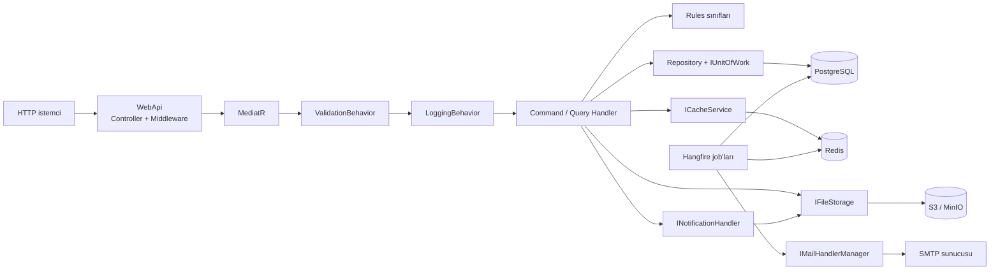
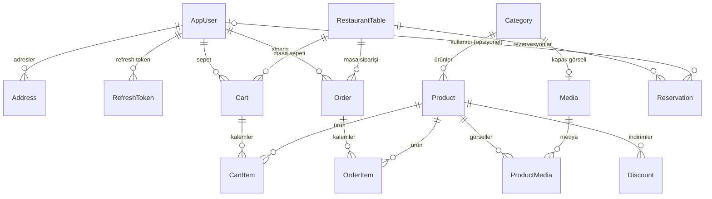

# RestaurantApi

Katmanlı mimariyle geliştirilen bir restoran yönetim API'si: menü (kategori/ürün), indirim ve masa yönetimi, JWT kimlik doğrulama, profil ve adres işlemleri.

> Proje aktif olarak geliştirilmeye devam ediyor; planlanan işler için [Yol haritası](#yol-haritası) bölümüne bakın.


## Projenin amacı

Restoranın menüsünü (kategoriler, ürünler, ürün görselleri, indirimler) ve masalarını yöneten bir backend. Yönetici senaryoları (kategori, ürün, indirim ve masa yönetimi) ile kullanıcı senaryoları (kayıt, giriş, iki faktörlü giriş, profil, adres) aynı API üzerinden sunulur. Masa güncelleme ve silme akışları, masadaki aktif rezervasyonları iş kuralları üzerinden dikkate alır.

## Öne çıkanlar

- **Masa yönetimi ve rezervasyon koruması:** listeleme (is-active / min-guest / max-guest / number filtreleri), detay, oluşturma, güncelleme ve pasife alma (`IsActive = false`). Aktif (Pending/Confirmed ve bitiş zamanı geçmemiş) rezervasyonu olan masa pasife alınamaz; kapasite, aktif rezervasyonlardaki en yüksek misafir sayısının altına düşürülemez.
- **Eşzamanlılık:** masa güncelleme ve silmede satır kilidi (`SELECT ... FOR UPDATE`) alınır; rezervasyon kontrolü ve yazma tek transaction içinde yapılır.
- **Kimlik doğrulama:** ASP.NET Core Identity + JWT access token, veritabanında saklanan refresh token, mail doğrulama, iki faktörlü giriş, şifre sıfırlama ve çıkış akışları.
- **İzin tabanlı yetkilendirme:** `Permissions` sabitlerinden üretilen authorization policy'leri; kullanıcının rolüne ait izin listesi Redis'te cache'lenir.
- **Redis cache:** liste uçları cache-aside deseniyle okunur. Cache miss olduğunda dağıtık kilit alınır, kilit alınamazsa kısa bir bekleme sonrası tekrar denenir; böylece eşzamanlı isteklerde veritabanına tek sorgu gider (cache stampede koruması). Değerler gzip ile sıkıştırılarak saklanır, mutasyonlarda ilgili cache anahtarları temizlenir.
- **Medya ve arka plan işler:** S3 uyumlu depoya görsel yükleme, güncelleme sonrası eski dosyaların event handler ile silinmesi, indirimlerin başlangıç/bitiş anlarında çalışan Hangfire job'ları ve arka planda gönderilen HTML mailler.
- **Test ve CI:** 570+ test (unit + integration); GitHub Actions üzerinde restore → build (Release) → test.

## Mimari

Çözüm dört katmandan oluşur ve bağımlılıklar içe doğru akar. `Domain` hiçbir katmana bağlı değildir. `Application` yalnızca `Domain`'e referans verir; CQRS yapıları, iş kuralları ve pipeline behavior'lar buradadır. `Persistence` (EF Core, repository'ler, Unit of Work, migration'lar, seed) ve `Infrastructure` (JWT, Redis, S3, mail, Hangfire, authorization handler'ları) `Application`'daki arayüzleri uygular. `WebApi` bu bileşenleri DI ile birleştirir; istekler controller → MediatR pipeline → handler → Rules + repository akışını izler.



### Domain modeli (özet)



## Önemli tasarım kararları

- **Feature bazlı CQRS (MediatR).** Her işlem `Features/<Modül>/Commands|Queries` altında kendi command/query, handler ve validator dosyalarıyla durur. Controller ince kalır ve bir davranışı ararken tüm akış tek klasörde bulunur.
- **İş kuralları ayrı `Rules` sınıflarında.** Handler'lar `RestaurantTableRules`, `DiscountRules`, `ProductRules` gibi sınıfları enjekte eder. Aynı kural (örn. `ShouldTableExist`, `ShouldTableNumberBeUnique`) birden fazla akışta tekrar kullanılır ve veritabanı olmadan unit test edilir.
- **Doğrulama ve loglama pipeline behavior'ları.** FluentValidation kontrolleri `ValidationBehavior` ile, süre loglaması `LoggingBehavior` ile tüm isteklere uygulanır; handler'larda tekrar eden kod oluşmaz. `ExceptionMiddleware` doğrulama hatalarını 400'e, iş kuralı hatalarını (`NotFoundException`, `ConflictException`, `UnprocessableEntityError`) ilgili HTTP kodlarına çevirir.
- **Satır kilidi ve tek transaction.** Masa güncelleme/silmede handler önce `IUnitOfWork.BeginTransaction` ile transaction açar; satır kilidi `IRestaurantTableRepository.GetByIdForUpdateAsync` metodu üzerinden `SELECT ... FOR UPDATE` sorgusuyla alınır (kilit sorgusu `Persistence` katmanındaki repository içindedir). Ardından rezervasyon kontrolleri yapılır, yazma aynı transaction içinde gerçekleştirilir ve `CommitTransactionAsync` ile bitirilir; bir adım hata verirse `RollbackTransactionAsync` çağrılır. Böylece araya giren bir rezervasyonun gözden kaçması engellenir ve `Application` katmanı ham SQL'e bağımlı olmaz.
- **Dosya ve cache işlemleri transaction dışında.** Yeni görseller transaction açılmadan **önce** S3'e yüklenir; ardından `IUnitOfWork` ile transaction açılır ve veritabanı değişiklikleri commit edilir. Commit sonrası Redis anahtarları temizlenir, güncellemede silinen eski görseller `UpdateProductEvent` / `UpdateCategoryEvent` notification handler'ları üzerinden depolamadan silinir. İşlem hata verirse yüklenen yeni dosyalar `IFileStorage.SafeDeleteMultipleFilesAsync` ile telafi edilir ve hata yeniden fırlatılır.
- **Listelerde okuma odaklı cache.** `GetOrInternalSetAsync` dağıtık kilit ve gzip sıkıştırma ile çalışır; eşzamanlı cache miss durumunda tek sorgu atılır. Masa listesi 30 dakika, diğer liste uçları 1 saat cache'lenir.
- **Reflection tabanlı izinler.** `Permissions` içine eklenen sabitler hem authorization policy'lerini hem veritabanı seed'ini hem de ADMIN rolüne atamayı otomatik besler; yeni izin için elle kayıt gerekmez.

## Teknoloji yığını

| Alan | Teknoloji |
| --- | --- |
| Runtime / framework | .NET 10, ASP.NET Core |
| Mesajlaşma / CQRS | MediatR |
| Doğrulama | FluentValidation |
| Nesne eşleme | AutoMapper |
| Kimlik doğrulama | ASP.NET Core Identity, JwtBearer, refresh token |
| Veritabanı | PostgreSQL, EF Core (Npgsql), kod tabanlı migration |
| Cache | Redis (StackExchange.Redis) |
| Arka plan işler | Hangfire (PostgreSQL storage) |
| Dosya depolama | AWS S3 SDK (MinIO uyumlu) |
| Mail | MailKit + RazorLight şablonları |
| Loglama | Serilog (Console + Seq) |
| API dokümantasyonu | Swagger / Swashbuckle (örneklerle) |
| Test | xUnit, FluentAssertions, NSubstitute, Testcontainers, Respawn |
| CI | GitHub Actions |

## Hızlı başlangıç

### Gereksinimler

- .NET 10 SDK
- Docker ve Docker Compose
- (Opsiyonel) `dotnet-ef` aracı — migration'ları elle uygulamak isterseniz

### 1) Repoyu klonlayın

```bash
git clone https://github.com/mrtmrngz/DotnetRestaurantWebApi.git
cd DotnetRestaurantWebApi
```

### 2) `.env` dosyasını oluşturun

`compose.api.yaml`, API konteynerinin ayarlarını `docker compose` değişkenleri olarak proje kökündeki `.env` dosyasından okur (dosya `.gitignore` içinde olduğu için repoda bulunmaz). Örnek içerik (parola/anahtar değerleri yer tutucudur):

```env
# PostgreSQL (compose.yaml'daki servis ile aynı olmalı)
POSTGRES_USER=user
POSTGRES_PASSWORD=<postgres-parolasi>

# Redis (compose.yaml'daki servis ile aynı olmalı)
REDIS_PASSWORD=<redis-parolasi>

# MinIO (S3 uyumlu depolama)
MINIO_ROOT_USER=<minio-kullanici>
MINIO_ROOT_PASSWORD=<minio-parolasi>

# JWT imza anahtarı (en az 32 karakter)
JWT_SECRET_KEY=<en-az-32-karakterli-anahtar>

# Mail (SMTP)
MAIL_HOST=smtp.gmail.com
MAIL_PORT=587
MAIL_EMAIL=<gonderen-eposta>
MAIL_PASSWORD=<smtp-uygulama-sifresi>
```

`POSTGRES_PASSWORD`, `REDIS_PASSWORD`, `MINIO_ROOT_USER`, `MINIO_ROOT_PASSWORD`, `JWT_SECRET_KEY`, `MAIL_EMAIL` ve `MAIL_PASSWORD` zorunludur; eksik olmaları durumunda `docker compose` hata verir. `POSTGRES_USER` varsayılanı `user`, `MAIL_HOST` varsayılanı `smtp.gmail.com`, `MAIL_PORT` varsayılanı `587`'dir. Veritabanı, Redis ve MinIO değerleri `compose.yaml`'daki servis tanımlarıyla aynı olmalıdır.

### 3) Servisleri başlatın

```bash
docker compose -f compose.yaml -f compose.api.yaml --profile dev --profile app-dev up -d --build
```

Bu komut PostgreSQL (`5432`), parola korumalı Redis (`6379`), RedisInsight (`5540`), Seq (`5341`), MinIO (`9000`, konsol `9001`) servislerini ve `images-bucket` bucket'ını oluşturan tek seferlik `createbuckets` job'ını başlatır; ardından `api-dev` konteynerini (`5269` → konteyner içinde `8080`) ayağa kaldırır.

Sıcak yeniden yükleme (hot reload) ile çalıştırmak için:

```bash
docker compose -f compose.yaml -f compose.api.yaml --profile dev --profile app-dev up --build --watch
```

Durdurmak için `docker compose -f compose.yaml -f compose.api.yaml --profile dev --profile app-dev down` kullanılır; `-v` verilmedikçe PostgreSQL, Redis, MinIO ve Seq volume verileri korunur.

### 4) Docker olmadan çalıştırma

API'yi yerelde (`dotnet run`) çalıştırmak isterseniz önce yalnızca altyapıyı başlatın:

```bash
docker compose --profile dev up -d
```

Ardından ayarları `dotnet user-secrets` ile tanımlayın. `appsettings.Development.json` da `.gitignore` içinde olduğu için repoda bulunmaz; `RestaurantApi.WebApi.csproj` içindeki `UserSecretsId` sayesinde bu değerler `Development` ortamında otomatik okunur. Parola/anahtar içeren değerler yer tutucudur:

```bash
cd src/RestaurantApi.WebApi

dotnet user-secrets set "ConnectionStrings:DefaultConnection" "Host=localhost;Port=5432;Database=restaurant-api;Username=<db-user>;Password=<db-password>"
dotnet user-secrets set "ConnectionStrings:Redis" "localhost:6379,password=<redis-password>"

dotnet user-secrets set "AWS:ServiceUrl" "http://localhost:9000"
dotnet user-secrets set "AWS:AccessKey" "<minio-access-key>"
dotnet user-secrets set "AWS:SecretKey" "<minio-secret-key>"
dotnet user-secrets set "AWS:Region" "eu-west-1"
dotnet user-secrets set "AWS:Bucket" "images-bucket"
dotnet user-secrets set "AWS:PublicBaseUrl" "http://localhost:9000"

dotnet user-secrets set "JwtSettings:SecretKey" "<en-az-32-karakterli-anahtar>"
dotnet user-secrets set "JwtSettings:Issuer" "restaurant-api"
dotnet user-secrets set "JwtSettings:Audience" "restaurant-api-client"
dotnet user-secrets set "JwtSettings:AccessTokenExpirationMinutes" "15"
dotnet user-secrets set "JwtSettings:RefreshTokenExpirationDays" "7"

dotnet user-secrets set "MailSettings:Host" "smtp.example.com"
dotnet user-secrets set "MailSettings:Port" "587"
dotnet user-secrets set "MailSettings:Email" "no-reply@example.com"
dotnet user-secrets set "MailSettings:Password" "<smtp-uygulama-sifresi>"
```

Veritabanı, Redis ve MinIO değerleri (kullanıcı adı, parola, veritabanı ve bucket adı) `compose.yaml`'daki servis tanımlarıyla aynı olmalıdır; parolaları depoya yazmayın.

Ardından uygulamayı çalıştırın:

```bash
dotnet run --project src/RestaurantApi.WebApi
```

Uygulama hangi biçimde başlatılırsa başlatılsın açılışta `SeedDataAsync()` çalışır: `Database.MigrateAsync()` ile migration'lar uygulanır, izinler ve roller seed edilir. Migration'ı elle uygulamak isterseniz:

```bash
dotnet ef database update --project src/RestaurantApi.Persistence --startup-project src/RestaurantApi.WebApi
```

### Adresler

| Servis | Adres |
| --- | --- |
| API | `http://localhost:5269` |
| Swagger UI (yalnız `Development`) | `http://localhost:5269/swagger` |
| Hangfire dashboard | `http://localhost:5269/hangfire` |
| Seq | `http://localhost:5341` |
| MinIO konsolu | `http://localhost:9001` |

`compose.yaml` altyapı servislerini, `compose.api.yaml` ise API konteynerini (`api-dev`) tanımlar. İmajı elle derlemek isterseniz çok aşamalı Dockerfile `src/RestaurantApi.WebApi/Dockerfile` içindedir (`development`, `build`, `publish`, `final` aşamaları; `8080` portunu açar):

```bash
docker build -f src/RestaurantApi.WebApi/Dockerfile -t restaurant-api .
```

## API uçları

Ayrıntılı parametreler, örnek istek/yanıtlar ve yetki bilgisi için Swagger UI'ı kullanın. Modül özeti:

- `api/auth` — kayıt, giriş, iki faktörlü giriş, mail doğrulama, token yenileme, şifre sıfırlama, çıkış
- `api/users` — oturumdaki kullanıcı bilgisi (`GET api/users/me`)
- `api/profile` — profil bilgisi ve şifre değiştirme
- `api/addresses` — adres listeleme, detay, oluşturma, güncelleme, silme
- `api/categories` — public ve admin kategori listeleme, detay, oluşturma, güncelleme, silme
- `api/products` — public ve admin ürün listeleme, detay, oluşturma, güncelleme, silme
- `api/discounts` — indirim listeleme (status filtresi), detay, oluşturma, güncelleme
- `api/tables` — masa listeleme (`is-active`, `min-guest`, `max-guest`, `number`), detay, oluşturma, güncelleme, silme
- `api/diagnostics/cache` — cache hit/miss sayaçları

Tüm uçların method, route, izin ve başarı kodu bilgisiyle tablo halindeki listesi: [docs/API.md](docs/API.md).

## Testler ve CI

```bash
dotnet test tests/RestaurantApi.UnitTests          # unit testler
dotnet test tests/RestaurantApi.IntegrationTests   # integration testler (Docker gerekir)
dotnet test RestaurantApi.sln                      # tüm testler
```

- **Unit testler:** xUnit, FluentAssertions ve NSubstitute; validator'lar ve `Rules` sınıfları veritabanı olmadan doğrulanır.
- **Integration testler:** Testcontainers ile PostgreSQL 16 ve Redis container'ları başlatılır. Respawn her testten sonra veritabanını temizler; Redis cache'i her testten sonra flush ile temizlenir. Admin ve normal kullanıcı token'ları üretilerek uçlar gerçek HTTP istekleriyle test edilir. Mail ve dosya depolama servisleri fake implementasyonlarla değiştirilir.
- **CI:** `.github/workflows/ci.yml` — `main` dalına push ve pull request'te checkout, .NET 10.0.x kurulumu, NuGet cache, `dotnet restore`, Release build ve `dotnet test` adımları çalışır.

## Proje yapısı

```text
RestaurantApi.sln
compose.yaml
.github/workflows/ci.yml
src/
  RestaurantApi.Domain/          entity'ler, enum'lar, Identity, Permissions
  RestaurantApi.Application/     Features (CQRS), Rules, behaviors, mapping profilleri
  RestaurantApi.Persistence/     DbContext, configurations, repository'ler, UoW, seed
  RestaurantApi.Infrastructure/  JWT, Redis, S3, mail, Hangfire, authorization
  RestaurantApi.WebApi/          controller'lar, middleware'ler, Swagger
tests/
  RestaurantApi.UnitTests/
  RestaurantApi.IntegrationTests/
```

## Geliştirme süreci

Bu projenin büyük bölümü Cline + DeepSeek ajanıyla geliştirilmektedir. Mimari kararları ben veriyorum; üretilen kodu inceliyor ve otomatik testlerle doğruluyorum.

## Yol haritası

Planlanan işler (kodda henüz uç noktası yok):

- **Rezervasyon uçları:** rezervasyon oluşturma, listeleme ve durum güncelleme. Domain modeli ve masa güncelleme/silme kuralları hazır durumda.
- **Sepet ve sipariş uçları:** `Cart`, `CartItem`, `Order` ve `OrderItem` modelleri veritabanında tanımlı.
- **Ödeme entegrasyonu.**
- **CORS politikası.**
- **Rate limiting.**
- **Güvenlik sertleştirmesi:** `api/diagnostics/cache` ucu ve Hangfire dashboard için yetkilendirme (CORS ve rate limiting ile birlikte).

## Bilinen sınırlamalar

- Masa numarası benzersizliği veritabanı kısıtı yerine uygulama seviyesinde (Rules) kontrol edilir; tek restoran ve az sayıda yönetici senaryosu için bilinçli bir tercihtir.
- İndirimler için silme ucu yok; indirim `PATCH api/discounts/{discountId}` ile pasife alınabilir.

## İletişim

- E-posta: [mert123marangoz@gmail.com](mailto:mert123marangoz@gmail.com)
- LinkedIn: [mert-marangoz](https://www.linkedin.com/in/mert-marangoz-53b990297/)
- GitHub: [mrtmrngz](https://github.com/mrtmrngz)

## Lisans

MIT — ayrıntı için [LICENSE](LICENSE).
