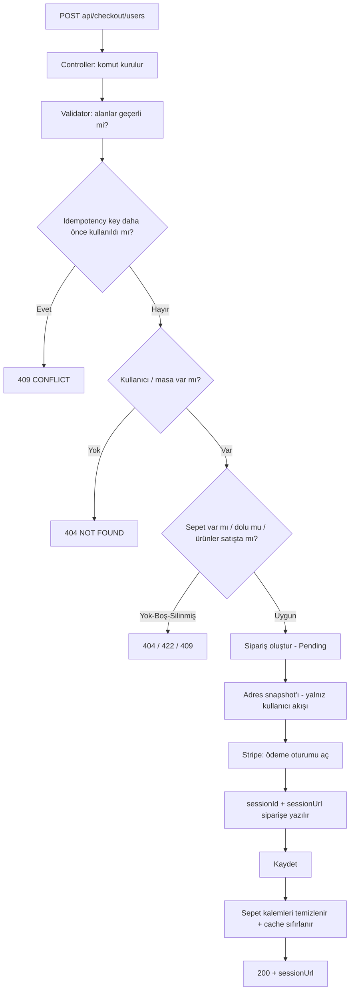

# 02 — Sipariş Oluşturma (Checkout) Akışı

Bu dosya şu sorunun cevabı: **"Sepetteki ürünler nasıl siparişe dönüşüyor ve müşteriye ödeme sayfası nereden geliyor?"**

## Bu akışın uçları

| Uç | Kim çağırır | Ne yapar |
| --- | --- | --- |
| `POST api/checkout/users` | Giriş yapmış müşteri | Kendi sepetini siparişe çevirir + Stripe ödeme sayfası açar |
| `POST api/checkout/tables/{tableId}/online` | Panel yetkilisi (`checkout:create`) | **Masanın** sepetini siparişe çevirir + Stripe ödeme sayfası açar |
| `POST api/checkout/tables/{tableId}/cash` | Panel yetkilisi (`checkout:create`) | Masanın sepetini **nakit ödemeli** siparişe çevirir (ödeme sayfası yok) |

Üçünde de zorunlu olan: **`X-Idempotency-Key` başlığı.**



---

## Adım adım: `POST api/checkout/users` ne yapıyor?

### 1) Controller komutu kurar — `CheckoutController.cs`

```csharp
var command = new CreateOnlineCheckoutCommand
{
    UserId = _currentUserService.UserId,   // token'dan, istemciden DEĞİL
    RestaurantTableId = null,
    IdempotencyKey = idempotencyKey,       // header'dan
    CheckoutRequestTypes = CheckoutRequestTypes.CurrentUser
};
```

- **Neden `UserId` istemciden alınmıyor?** İstemciden alınsaydı, A kullanıcısı B'nin sepetini siparişe çevirebilirdi. Kimlik **token'dan** okunur.
- **Neden `[BindNever]` / `[JsonIgnore]`?** Command alanlarının istek gövdesinden doldurulmasını engeller; gövdeye `userId` yazıp başka kullanıcı taklit etme yolu kapanır.
- **Neden `IdempotencyKey` header'da?** "Öde" butonuna iki kez basılırsa aynı anahtar gelir; ikinci istek 409 alır, **ikinci sipariş açılmaz**.

### 2) Validator çalışır — `CreateOnlineCheckoutCommandValidator.cs`

MediatR pipeline'ı her komuttan önce validator'ları koşar (`ValidationBehavior`). Kurallar:

| Kural | Neden |
| --- | --- |
| `IdempotencyKey` zorunlu, ≤ 150 karakter | Zorunlu: mükerrer sipariş koruması. 150: veritabanındaki `IdempotencyKey` kolonu 150 karakter |
| `CurrentUser` ise `UserId` dolu ve `TableId` **boş** olmalı | "Kim ödüyor?" sorusunun tek cevabı olmalı; ikisi birden doluysa hangi sepetin siparişe çevrileceği belirsiz |
| `PanelUser` ise `TableId` dolu ve `UserId` **boş** olmalı | Aynı sebep |
| `Guid.Empty` reddedilir | Boş GUID = "bulunamadı" demek; sessizce yanlış kayda yazmaktansa baştan reddetmek doğru |

### 3) Idempotency kontrolü → gerekiyorsa **409**

Aynı `IdempotencyKey` ile daha önce **aynı kullanıcı/masa** için sipariş açılmışsa `ConflictException` atılır.

- **Neden burada, veritabanı kısıtıyla değil?** Uygulama seviyesinde **anlamlı bir hata mesajı** (409 + açıklama) dönebilmek için. Kısıt ihlali 500 gibi görünürdü.
- **Neden "aynı kullanıcı/masa" koşulu var?** Aynı anahtar farklı kişilerce üretilirse (ör. iki farklı müşteri aynı UUID'yi kullanırsa) birbirlerini bloklamasın diye.

### 4) Hedef varlık kontrolü → yoksa **404**

`ICartService.ValidateTargetEntityForCheckoutAsync(...)`:

- Kullanıcı akışında kullanıcının var olduğu doğrulanır.
- Masa akışında masa **var ve aktif** olmalıdır; pasif masa **"bulunamadı"** olarak döner.
  - **Neden pasif masa için 404, 403/422 değil?** Pasif masayı "sipariş veremez" diye ayrı bir cevapla anlatmak, dışarıya "bu id'de bir masa var ama kapalı" bilgisini sızdırırdı. Ayrıca iş açısından o masa müşteri için yoktur.
  - **Neden bu kontrol burada?** Sepeti bulup sipariş oluşturmaya başlamadan önce hedefin geçerliliği netleşsin; yarı yolda hata verip yarım iş bırakmayalım.

### 5) Sepet doğrulaması → **404 / 422 / 409**

| Durum | Sonuç | Neden |
| --- | --- | --- |
| Sepet yok | 404 `Sepet bulunamadı.` | Sipariş edilecek bir şey yok |
| Sepet var ama **boş** | 422 `Sepetinizde sipariş oluşturulacak ürün bulunmuyor.` | 422 = "istek biçimsel olarak doğru ama iş kurallarına uygun değil" |
| Sepette **satıştan kaldırılmış** ürün var | 409 `Sepette artık satışta olmayan ürünler var.` | Müşteri silinmiş bir ürünü ödememeli; sessizce düşürmek yanlış tutar demek |

**Kritik teknik detay:** `Product` için **global query filter** vardır (silinmiş ürünler sorgulardan otomatik çıkar). Sepet çekilirken bu filtre bilinçli olarak **kapatılır** (`IgnoreQueryFilters`) — yoksa silinmiş ürün sepette "hiç yokmuş" gibi görünür ve yukarıdaki 409 hiç üretilemezdi.

### 6) Sipariş oluşturulur — `Order.CreateFromCart(...)`

Domain'in (iş kurallarının) sahibi burasıdır: handler "nasıl" bilmez, `Order` bilir.

| Kural | Neden |
| --- | --- |
| `IdempotencyKey` boş olamaz | Mükerrer sipariş koruması veritabanına kadar inmeli |
| Kullanıcı **veya** masa dolu olmalı, ikisi birden olmamalı | Sipariş tek bir sahibe aittir |
| `Guid.Empty` reddedilir | Boş GUID = geçersiz sahip |
| Sepet boş olamaz | Boş sipariş anlamsız (bu koruma **yedek katman**; asıl kontrol 422 ile yapıldı) |
| `Quantity > 0` | Sıfır/negatif adet sipariş edilemez |
| `Product` yüklenmiş olmalı | Fiyat ve ürün adı ürün nesnesinden okunur; yüklenmemişse sessizce 0 TL'lik sipariş oluşurdu |
| Fiyat = **o an geçerli indirim** uygulanmış hâli | İndirim sonradan değişse bile sipariş o günkü fiyatı taşır |
| `ProductSnapshot` yazılır | Ürün adı/fiyat/indirim oranı siparişte "fotoğraf" olarak kalır; ürün silinse de geçmiş bozulmaz |
| `CalculateTotals()` | `SubTotal = Σ kalem toplamı`; burada hata olursa para yanlış gider |

**Kargo kuralı (`CalculateShipping`)** tamamen domain kararıdır:

| Sipariş sahibi | Kargo |
| --- | --- |
| Masa (`RestaurantTableId` dolu) | **0 TL** (masada yeniyor, teslimat yok) |
| Kullanıcı, `SubTotal ≥ 500` | 0 TL (ücretsiz kargo) |
| Kullanıcı, `SubTotal < 500` | 120 TL |

Aynı kural **Stripe'a gönderilen kalemlere** de yansır: kargo varsa ayrıca **"Kargo"** adlı satır kalemi eklenir. Neden? Stripe'ta tahsil edilen tutar = gönderilen kalemlerin toplamıdır. Kargo kalemi eklenmeseydi müşteri kargoyu ödemez ve tahsilat ile sistemdeki toplam **tutmazdı**.

### 7) Adres (yalnız `CurrentUser` akışı)

Kullanıcının **varsayılan** adresi bulunur; yoksa 404. Bulunan adres `HandleSetAddress` ile siparişe **JSON snapshot** olarak yazılır.

- **Neden snapshot?** Adres sonradan silinse/değiştirilse de "sipariş o gün nereye gidecekti" kaydı bozulmaz.
- **Neden masa akışında yok?** Masaya servis ediliyor; adres anlamsız, boşuna veri tutulmaz.

### 8) Stripe ödeme oturumu açılır — `IPaymentService.CreateCheckoutSessionAsync`

Arkasında `Infrastructure/Services/PaymentService.cs` vardır (Application katmanı Stripe'ı **hiç bilmez**). Yapılanlar:

| Yapılan | Neden |
| --- | --- |
| `Mode = "payment"` | Tek seferlik ödeme (abonelik değil) |
| `Locale = "tr"` | Türkçe ödeme sayfası |
| `SuccessUrl` / `CancelUrl` | Müşterinin ödeme sonrası döneceği ön yüz adresleri |
| `ExpiresAt = şimdi + 1 saat` | Ödeme sayfası sonsuza kadar açık kalmasın (Stripe 30 dk – 24 saat arasını kabul eder) |
| Kalemler: ürün adı + **indirimli birim fiyat**, `× 100` (kuruş) | Stripe tam sayı ister; siparişle birebir aynı tutarı göstermek zorundayız |
| "Kargo" kalemi (varsa) | Tahsil edilen tutar = sipariş toplamı |
| `metadata.order_id` ve arkadaşları | Webhook geldiğinde siparişi bulabilmek için |
| `RequestOptions.IdempotencyKey = order.IdempotencyKey` | Ağ hatası olup istek tekrar denenirse Stripe **ikinci oturum açmaz** |
| `SecretKey` yoksa `InvalidOperationException` (500) | Eksik yapılandırma iş kuralı hatası değildir; 422 dönmek yanlış teşhis olurdu |
| Stripe hata verirse `UnprocessableEntityError` (422) | "Şu an ödeme başlatılamadı" — kullanıcıya anlamlı mesaj, bize log |

### 9) Oturum bilgisi siparişe yazılır — `AttachCheckoutSession`

`sessionId`, `sessionUrl`, `expiresAt` sipariş kaydına işlenir. Neden gerekli?

- **Hangi sipariş hangi oturuma ait?** Webhook çoğu zaman yalnızca oturum id'siyle gelir; eşleşme bu alanla kurulur (metadata gelse bile **ikinci bir eşleme yolu** olur).
- Domain kuralı: bu metot yalnızca `PaymentStatus == Pending` iken ve **gelecekteki** bir bitiş zamanıyla çağrılabilir → "ödenmiş siparişe yeni oturum bağlama" yolu kapalıdır.

### 10) Kaydet — tek `SaveChangesAsync`

Sipariş ve kalemleri **tek transaction** içinde yazılır: ya hepsi ya hiçbiri. "Kalemsiz sipariş" gibi yarım kayıt veritabanına düşmez.

### 11) Sepet kalemleri temizlenir + cache sıfırlanır

- Kalemler `ExecuteDeleteAsync` ile silinir (tek SQL), **sepet kaydı kalır**.
  Neden sepet kalıyor? Sepet "masanın/kullanıcının sepeti"dir; kayıt silinirse masa yeniden sipariş vermek istediğinde her şey sıfırdan kurulmak zorunda kalır. Kalemleri silmek yeterli.
- `InvalidateCartCache` çağrılır. Neden? Sepet listeleme uçları Redis'te **cache**'lenir; cache temizlenmezse müşteri "sipariş verdim ama sepetim hâlâ dolu görünüyor" görürdü.

### 12) Cevap: `200` + `sessionUrl`

```json
{ "sessionUrl": "https://checkout.stripe.com/c/pay/cs_...", "code": "CHECKOUT_SESSION_CREATED" }
```

Ön yüz bu adrese yönlendirir. **Cevapta "ödeme başarılı" bilgisi yoktur** — çünkü henüz ödeme olmadı; doğru cevap budur.

---

## Neden sipariş `Pending` doğar?

`Order.CreateFromCart(..., OrderStatus.Pending)` çağrılır ve `PaymentStatus.Pending` olur, çünkü **para henüz alınmadı**. Siparişi "hazırlanıyor" gibi göstermek, ödeme gelmeden mutfağı çalıştırmak demektir.

Bu bilinçli bir tasarımın sonucudur: **para ile mutfak süreci ayrı iki eksendir.**

| Eksen | Anlamı |
| --- | --- |
| `OrderStatus` | Mutfak/servis süreci (`Pending → Confirmed → Preparing → Ready → …`) |
| `PaymentStatus` | Para durumu (`Pending → Paid / Failed`) |

Webhook geldiğinde yalnızca `PaymentStatus` yazılır; sipariş durumu mutfak akışının işidir (bkz. [03](03-webhook-odeme-sonucu-akisi.md)).

---

## Nakit akışı neden farklı? (`POST api/checkout/tables/{tableId}/cash`)

| Konu | Online (Stripe) | Nakit (cash) |
| --- | --- | --- |
| Ödeme sayfası | Açılır (`sessionUrl` döner) | **Açılmaz** |
| `OrderStatus` | `Pending` | **`Confirmed`** |
| `PaymentStatus` | `Pending` → webhook ile netleşir | **`Paid`** (para masada elden alınıyor) |
| `CheckoutSessionId` | Dolu | Boş |
| Cevap | `CheckoutResponse` (`sessionUrl`) | `BaseResponse` (`CHECKOUT_SUCCESS`) |
| Adres / kargo | Varsayılan adres + kargo kuralı | Adres yok, kargo **0** |
| Webhook ilişkisi | Var (sonuç oradan gelir) | **Yok** (sonuç baştan kesin) |

Teknik detay: nakit akışında `order.MarkPaid()` **`SaveChanges`'ten önce** çağrılır. Böylece veritabanına tek `INSERT` ile `Paid` olarak yazılır; "önce ekle sonra güncelle" şeklinde gereksiz ikinci yazma ve kısa süreli tutarsız durum oluşmaz.

---

## Bilinen açık nokta (bilinçli tercih)

Akış sırası: **önce Stripe'ta oturum açılır, sonra veritabanına yazılır.**
Veritabanı yazımı başarısız olursa Stripe'ta açılmış bir oturum kalır ve kimse ödemez; oturum **1 saat sonra kendiliğinden kapanır**.

Ters sıralama (önce DB, sonra Stripe) bilinçli olarak seçilmedi: o senaryoda "sipariş var ama ödeme linki yok" gibi **kullanıcıya dönük kırık** bir kayıt oluşurdu. Şimdiki hâlde en kötü durum "kullanılmayan bir ödeme linki"dir: para kaybı ve yanlış sipariş yok.

---

Devamı: [03 — Webhook: ödeme sonucu akışı](03-webhook-odeme-sonucu-akisi.md)