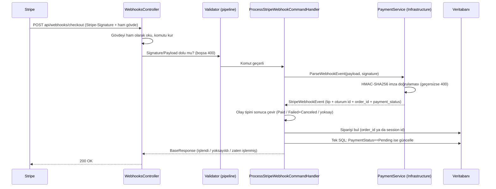

# 03 — Webhook: Ödeme Sonucu Akışı

Bu dosya şu sorunun cevabı: **"Stripe 'para geldi' dediğinde sipariş tam olarak nasıl `Paid` oluyor ve neden bu kodlar bu şekilde yazıldı?"**

Uç: `POST api/webhooks/checkout` — **anonim** (token yok), güvenliği **imza** sağlar.

---

## Büyük resim: bir webhook isteğinin yolculuğu



---

## İstek zinciri: hangi dosya hangi işi yapar?

| Sıra | Dosya | Görev | Neden ayrı? |
| --- | --- | --- | --- |
| 1 | `WebApi/Controllers/WebhooksController.cs` | Ham gövdeyi ve `Stripe-Signature` başlığını alır, komutu kurar | HTTP dünyası (header/stream) yalnızca burada bilinir |
| 2 | `Application/.../ProcessStripeWebhookCommand.cs` | Taşıyıcı: `Signature` + `Payload` | Controller ile iş mantığı arasında **veri sözleşmesi** |
| 3 | `.../ProcessStripeWebhookCommandValidator.cs` | Alan varlığı + boyut sınırları | Bozuk/şişirilmiş istek iş mantığına hiç ulaşmasın |
| 4 | `.../ProcessStripeWebhookCommandHandler.cs` | İş akışı: doğrula → olayı yorumla → siparişi bul → güncelle | "Ne olacak?" sorusunun tek adresi |
| 5 | `Infrastructure/Services/PaymentService.cs` | **Stripe'a özel** işler: imza doğrulama, olayı modele çevirme | Stripe kütüphanesi yalnızca burada; Application onu tanımaz |
| 6 | `Application/Common/Enums/StripeWebhookEventTypes.cs` | Sağlayıcıdan bağımsız olay tipleri | Sağlayıcı değişse iş mantığı aynı kalır |
| 7 | `Application/Models/Dtos/PaymentDtos/StripeWebhookEvent.cs` | İhtiyaç duyduğumuz 5 alan | Tüm Stripe modelini içeri taşımaya gerek yok |

---

## 1) Controller neyi neden yapıyor?

```csharp
[HttpPost("checkout")]                      // api/webhooks/checkout
[AllowAnonymous]                            // Stripe'ta JWT yok
[Consumes("application/json")]
public async Task<IActionResult> CheckoutWebhookRoute(
    [FromHeader(Name = "Stripe-Signature"), Required] string signature,
    CancellationToken cancellationToken)
{
    using var reader = new StreamReader(Request.Body);
    string payload = await reader.ReadToEndAsync(cancellationToken);
    ...
    BaseResponse response = await _mediator.Send(command, cancellationToken);
    return Ok(response);
}
```

| Satır | Neden var? |
| --- | --- |
| `[AllowAnonymous]` | Stripe bize token göndermez; kimlik doğrulaması **imza** ile yapılır. Bunu açıkça yazmak, ileride global bir yetki politikası eklenirse ucun yanlışlıkla kapanmamasını da sağlar |
| `Stripe-Signature` header'ı | İsteğin gerçekten Stripe'tan geldiğinin **tek kanıtı** |
| Gövdenin **ham** okunması | İmza, gövdenin **bayt bayt aynısı** üzerinden hesaplanır. `[FromBody]` ile model binding kullanılsaydı gövde yeniden serileştirilir (boşluk, alan sırası, kaçış karakterleri değişebilir) ve **imza tutmazdı** |
| `CancellationToken` | Müşteri/Stripe bağlantıyı kapatırsa gereksiz iş yapmayı bırakırız (boşa DB yazımı olmaz) |
| `[Consumes("application/json")]` | Yanlış içerik tipini baştan ayırır ve Swagger'da doğru görünür |
| Controller'ın "ince" olması | Karar vermez, taşır. İş kuralı değişince controller'a dokunmayız |

**Neden komut alanları `[BindNever]` + `[JsonIgnore]`?** (`ProcessStripeWebhookCommand.cs`)
Bu komut **istek gövdesinden doldurulmaz**; controller elle doldurur. Etiketler, birinin yanlışlıkla gövdeden alan bağlamasını ve saldırganın istek gövdesine `signature` yazarak doğrulamayı atlatmasını engeller.

**Validator neden boyut sınırı koyuyor?** (`ProcessStripeWebhookCommandValidator.cs`)

| Kural | Neden |
| --- | --- |
| `Signature` zorunlu, ≤ 1024 | İmza başlığı ~200 karakterdir; 1024 üstü anormaldir (şişirilmiş başlık = saldırı denemesi) |
| `Payload` zorunlu, ≤ 1 MB | Oturum olayları birkaç KB'dir; büyük gövde ile belleği/CPU'yu tüketmeye çalışan isteği **imza hesabına girmeden** reddederiz |

> Not: Projede `SuppressModelStateInvalidFilter = true` olduğu için `[Required]` etiketi otomatik 400 üretmez; bu yüzden boş imza kontrolü **validator'da** ayrıca vardır.

## 2) İmza doğrulama — `PaymentService.ParseWebhookEvent` (Infrastructure)

```csharp
stripeEvent = EventUtility.ConstructEvent(payload, signature, _stripeSettings.WebhookSecret,
    throwOnApiVersionMismatch: false);
```

Satır satır "neden":

| Kod | Neden var? | Olmasaydı ne olurdu? |
| --- | --- | --- |
| `payload`/`signature` boş mu kontrolü | Erken ve net 400 | Boş değerle kripto hesabı yapmak anlamsız; hata mesajı kafa karıştırıcı olurdu |
| `WebhookSecret` boş mu → `InvalidOperationException` (500) + `LogCritical` | Eksik **yapılandırma** bir iş kuralı hatası değildir | 400/422 dönseydik "Stripe yanlış gönderdi" sanılırdı; gerçek sebep sunucu ayarıdır |
| Doğrulamayı **Stripe SDK** yapıyor | İmza karşılaştırması ayrıntılı iştir (zaman damgası penceresi, birden çok `v1` imzası, hex çözümleme) | Kendi HMAC kodumuzu yazsaydık zaman karşılaştırmasını yanlış yapma riski yüksekti — güvenlikte "kendi kriptonu yazma" kuralı |
| `throwOnApiVersionMismatch: false` | Hesabımızın Stripe API sürümü SDK'dan farklı olabilir; bu bir güvenlik sorunu değil | Gereksiz 400'ler: her Stripe sürüm güncellemesinde webhook'lar kırılırdı |
| `StripeException` → `BadRequestException` (400) + `LogWarning` | Geçersiz/bozulmuş/eski imza = "sen Stripe değilsin" | Sessizce yutulsaydı saldırı denemeleri görünmez olurdu |
| `MapEventType(...)` sabitlerle (`EventTypes.*`) | Yazım hatası **derleme zamanında** yakalanır | Elle `"checkout.session.completed"` yazsaydık harf hatası sessizce "yoksay" davranışına dönüşürdü |
| Olay nesnesi `Session` değilse boş model döner | İşleyemediğimiz veriyi zorla okumayız | Çökme/yanlış eşleme riski |
| `metadata["order_id"]`, `session.Id`, `payment_status` | Bize siparişi bulmak için gereken **3 bilgi** | Bunlar olmadan hangi siparişin güncelleneceği bilinemez |

**Neden bu kod Application'da değil?**
Çünkü `EventUtility` ve `Session` tipleri Stripe kütüphanesine aittir; kütüphane yalnızca `Infrastructure`'da referanslıdır. Application katmanı sadece **kendi modelini** (`StripeWebhookEvent`) görür. Faydası: yarın ödeme sağlayıcısı değişse iş mantığı (handler) hiç değişmez; yalnızca bu servis yeniden yazılır.

---

## 3) Olay → sipariş sonucu eşlemesi — `ResolveTransition`

| Stripe olayı | Ek koşul | Uygulanan sonuç |
| --- | --- | --- |
| `checkout.session.completed` | `payment_status` = `paid` **veya** `no_payment_required` | `PaymentStatus.Paid` |
| `checkout.session.completed` | diğer `payment_status` değerleri (`unpaid`, `processing`) | **Yoksayılır** → 200 `STRIPE_WEBHOOK_IGNORED` |
| `checkout.session.async_payment_succeeded` | — | `PaymentStatus.Paid` |
| `checkout.session.async_payment_failed` | — | `PaymentStatus.Failed` + `OrderStatus.Canceled` |
| `checkout.session.expired` | — | `PaymentStatus.Failed` + `OrderStatus.Canceled` |
| Diğer tüm olaylar (`payment_intent.*` vb.) | — | **Yoksayılır** → 200 `STRIPE_WEBHOOK_IGNORED` |

### Neden `checkout.session.completed` tek başına "ödendi" sayılmıyor?

Bu, projedeki **en kritik güvenlik/para kuralıdır**:
Bazı ödeme yöntemleri asenkron çalışır. Oturum "tamamlandı" görünür ama `payment_status` hâlâ `unpaid` olabilir; para **sonra** gelir (ya da gelmez).

Tek başına `completed`'a güvenseydik: ödenmemiş bir sipariş `Paid` yazılır, mutfağa gider ve biz bedeli tahsil edememiş olurduk. Bunun yerine "kesin bilgi gelene kadar bekle" diyoruz; sonuç `async_payment_succeeded` ya da `async_payment_failed` ile kesinleşir.

### Neden başarısız/iptal edilen ödeme siparişi de iptal ediyor?

Çünkü **ödemesi alınmamış bir sipariş üretime girmemelidir.** Bu geçiş, domain'deki `Order.MarkExpired()` ile birebir aynı semantiktir (`Canceled` + `Failed`).

> Eğer "ödeme başarısız olsa da sipariş açık kalsın, müşteri tekrar ödesin" senaryosu istenirse: `FailedOrderTransition` tanımından `OrderStatus.Canceled` kaldırılır (tek satır) ve sipariş `Pending` durumda bekler.

### Neden işlenmeyen olaylarda 200 dönüyoruz?

Stripe, **2xx dışı bir cevap alırsa olayı tekrar göndermeye başlar** (günlerce). İlgilenmediğimiz bir olay (`payment_intent.created` gibi) için ısrarla tekrar denemesini istemeyiz → 200 + `STRIPE_WEBHOOK_IGNORED` + log.

## 4) Sipariş bulunur — `ResolveOrderIdAsync`

İki yol deniyoruz, çünkü **tek yol bırakmak kırılgan olur**:

| Sıra | Yol | Neden |
| --- | --- | --- |
| 1 | Metadata'daki `order_id` (`Guid.TryParse`) | Bizim yazdığımız, en güvenilir bilgi; ek sorgu gerekmez |
| 2 | Siparişte kayıtlı `CheckoutSessionId` | Metadata kaybolsa/gelmezse eşleşme devam eder |

Kontroller:

| Durum | Davranış | Neden? |
| --- | --- | --- |
| Sipariş bulunamadı | `NotFoundException` → **404** + `LogError` | Sessizce 200 dönseydik **gerçek bir ödeme kaydı kaybolabilirdi**. 404 dönünce Stripe olayı tekrar gönderir ve sorun görünür olur |
| Olayın oturumu, siparişin kayıtlı oturumuyla uyuşmuyor | `ConflictException` → **409** + `LogError` | Bir siparişe başka bir ödeme oturumunun sonucu yazılmasın (karışıklık = yanlış kişinin parası) |
| Sipariş var, `CheckoutSessionId` boş (ör. nakit akışı) | Uyuşmazlık kontrolü atlanır | Nakit siparişte oturum yoktur; "eşleşmedi" diye hata vermek yanlış olurdu. Böyle bir olay gelse bile `Pending` koşulu onu güncellemez |

---

## 5) Sipariş güncellenir — tek SQL, koşullu (`ExecuteUpdateAsync`)

```csharp
var query = _orderRepository.GetAllAsQueryable()
    .Where(x => x.Id == orderId && x.PaymentStatus == PaymentStatus.Pending);

return transition.OrderStatus.HasValue
    ? await query.ExecuteUpdateAsync(s => s
        .SetProperty(x => x.PaymentStatus, transition.PaymentStatus)
        .SetProperty(x => x.OrderStatus, transition.OrderStatus.Value), ct)
    : await query.ExecuteUpdateAsync(s => s.SetProperty(x => x.PaymentStatus, transition.PaymentStatus), ct);
```

| Tasarım | Neden? |
| --- | --- |
| `ExecuteUpdateAsync` (tek SQL) | Kaydı çekip değiştirip kaydetmeye (read-modify-write) göre daha az sorgu, daha az yarış (race) riski. İki alan tek ifadede güncellenir → arada tutarsız durum olmaz |
| `WHERE PaymentStatus == Pending` | **Idempotency'nin kalbi:** ödeme sonucu bir kez yazılır. Aynı olay tekrar gelse ya da **gecikmiş** bir `expired` olayı sonradan gelse, sonuçlanmış (`Paid`) bir sipariş **asıla düşürülemez** |
| `affectedRowCount == 0` ise özel mesaj | "Olay daha önce işlenmiş, sipariş durumu değiştirilmedi." → durum açıkça raporlanır, kullanıcı (Stripe) yine 200 alır |
| Domain metotları (`MarkPaid`) yerine SQL | Toplu/atomik güncelleme tercihi. **Semantik aynı tutuldu:** başarılı → sadece `PaymentStatus`; başarısız → `Canceled` + `Failed` (bkz. `Order.MarkPaid` / `MarkExpired`) |

> Alternatif: kaydı çekip `order.MarkPaid()` çağırıp `SaveChanges` yapmak. Bu daha "domain dostu" ama iki sorgu gerektirir ve "önce oku sonra yaz" arasında başka bir istek araya girebilir. Koşullu tek SQL, para akışında daha güvenli olduğu için tercih edildi.

---

## Cevap sözleşmesi (Stripe'ın gördüğü)

| HTTP | `code` | Mesaj | Ne zaman |
| --- | --- | --- | --- |
| 200 | `STRIPE_WEBHOOK_PROCESSED` | "Ödeme onaylandı, sipariş ödendi olarak işaretlendi." | Başarılı ödeme yazıldı |
| 200 | `STRIPE_WEBHOOK_PROCESSED` | "Ödeme başarısız olduğu için sipariş iptal edildi." | Başarısız/expired yazıldı |
| 200 | `STRIPE_WEBHOOK_PROCESSED` | "Olay daha önce işlenmiş, sipariş durumu değiştirilmedi." | Mükerrer olay |
| 200 | `STRIPE_WEBHOOK_IGNORED` | "Olay işlenmedi, istek yoksayıldı." | Bilmediğimiz/henüz sonuçlanmamış olay |
| 400 | `BAD_REQUEST` / doğrulama listesi | "Webhook imzası doğrulanamadı." / alan hataları | İmza geçersiz, gövde boş/bozuk/çok büyük |
| 404 | `NOT_FOUND` | "Webhook olayına ait sipariş bulunamadı." | Eşleşen sipariş yok (Stripe tekrar dener) |
| 409 | `CONFLICT` | "Webhook olayı siparişin ödeme oturumuyla eşleşmiyor." | Oturum uyuşmazlığı |
| 500 | — | "Stripe yapılandırması eksik: 'Stripe:WebhookSecret'…" | Sunucu ayarı eksik |

Kod eşlemesini yapan yer: `WebApi/Middlewares/ExceptionMiddleware.cs`. İş kuralı hataları (`AppException`) kendi HTTP kodu + `code` alanıyla döner; beklenmeyen hatalar 500 olur.

---

## Loglama politikası (bilinçli)

| Loglanır | Loglanmaz |
| --- | --- |
| `EventId`, olay tipi, `SessionId`, `OrderId` | **İstek gövdesinin tamamı** (müşteri adı, adres, e-posta olabilir) |
| İmza doğrulanamadı uyarısı (`LogWarning`) | İmza değeri ve **webhook secret** (asla) |
| Sipariş bulunamadı / oturum uyuşmazlığı (`LogError`) | Kart ile ilgili hiçbir bilgi (bizde zaten yok) |

Neden: log dosyaları çoğu zaman daha az korunur. Gereksiz kişisel veri ve sırları loga yazmak, kazandırdığından fazlasını kaybettirir.

---

## Özet: bu akıştaki 4 altın kural

1. **İmza doğrulanmadan hiçbir şey yapılmaz** (400).
2. **Para bilgisi yalnızca Stripe'ın kesinleşmiş olayından** yazılır; `completed` tek başına yetmez.
3. **Yalnızca `Pending` sipariş güncellenir** → idempotent ve geri alınamaz hatalara kapalı.
4. **Sonuç bulunamazsa sessiz kalınmaz** (404 → Stripe tekrar dener), **ilgisiz olayda 2xx dönülür** (gereksiz retry olmasın).

Devamı: [04 — Güvenlik ve tasarım kararları](04-guvenlik-ve-tasarim-kararlari.md)