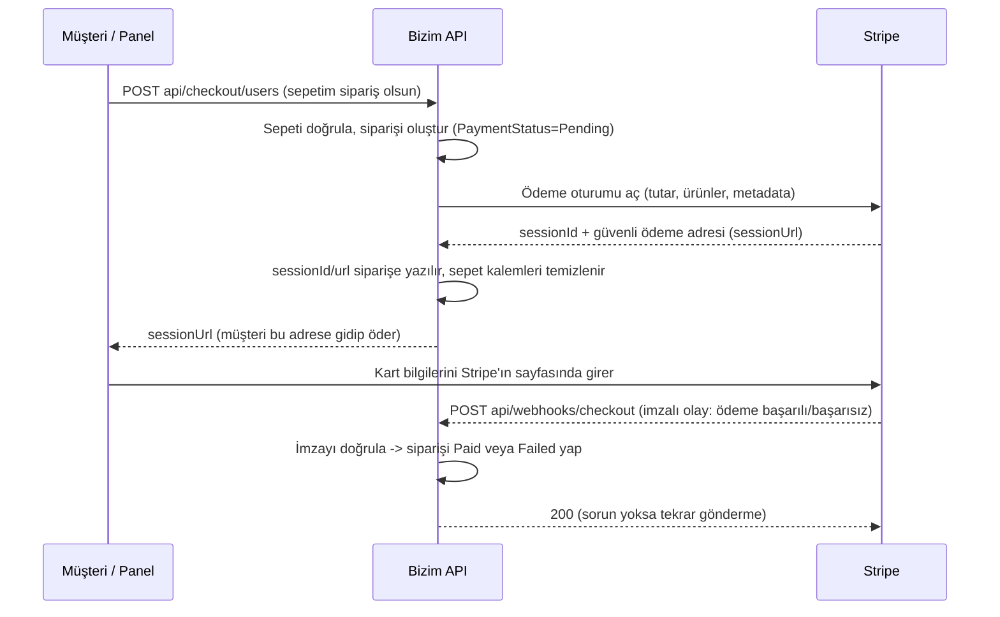

# Ödeme (Checkout & Webhook) Akışı — Kod Rehberi

Bu klasör, projedeki **ödeme (checkout)** ve **Stripe webhook** kodlarının **ne yaptığını**, **neden var olduğunu** ve **neden o şekilde yazıldığını** anlatır.

Amaç tek bir soruya cevap vermek: **"Bu satır neden burada?"**
Kodu yazarken "çalışıyor" demek yetmez; birkaç ay sonra kodu okuyan (ya da hata ayıklayan) kişinin "bunu neden böyle yapmışız?" sorusunu cevaplayabilmesi gerekir. Bu doküman o cevabı saklar.

> Kapsam: ödeme/checkout/webhook üretim kodu. **Testler bu dokümanın dışındadır.**
>
> 👉 Sadece **webhook kodunu satır satır** okumak istiyorsan: [../stripe-webhook/README.md](../stripe-webhook/README.md)

---

## Nasıl okunmalı?

| Sıra | Dosya | Ne anlatıyor |
| --- | --- | --- |
| 1 | [01-temel-kavramlar.md](01-temel-kavramlar.md) | Stripe, ödeme oturumu, webhook, imza, idempotency… (sıfırdan, benzetmelerle) |
| 2 | [02-siparis-olusturma-akisi.md](02-siparis-olusturma-akisi.md) | `POST api/checkout/...` — sepet nasıl siparişe dönüşür, ödeme sayfası neden açılır |
| 3 | [03-webhook-odeme-sonucu-akisi.md](03-webhook-odeme-sonucu-akisi.md) | `POST api/webhooks/checkout` — ödeme sonucu siparişe nasıl yazılır |
| 4 | [04-guvenlik-ve-tasarim-kararlari.md](04-guvenlik-ve-tasarim-kararlari.md) | İmza doğrulama, replay koruması, neden 404/200/409 dönüyoruz, katman kararları |
| 5 | [05-senaryolar-ve-ornekler.md](05-senaryolar-ve-ornekler.md) | Gerçek JSON örnekleriyle uçtan uca senaryolar |
| 6 | [06-sozluk.md](06-sozluk.md) | Terim sözlüğü (Stripe jargonunun Türkçesi) |

---

## 30 saniyede büyük resim

**Burada iki ayrı iş vardır ve karıştırılmamalıdır:**

1. **Siparişi açan akış** (`checkout`): "sepettekileri sipariş yap ve bana ödeme sayfası ver".
   Bu akış ödemenin sonucunu **bilmez**, bilmesi de beklenmez. Sipariş `PaymentStatus.Pending` olarak doğar.
2. **Ödeme sonucunu yazan akış** (`webhook`): Stripe "para geldi / gelmedi / süre doldu" dediğinde siparişi güncelleyen akış.
   Bu uç **bizim kullanıcımıza değil, Stripe'a** açılmıştır (bu yüzden token yok, imza var).

Neden böyle ayrıldı? Çünkü müşteri ödeme sayfasından bizim sitemize **hiç dönmeyebilir** (sekmeyi kapatabilir, internet kopabilir). Buna rağmen para Stripe'a **ulaşmış** olabilir. "Para gerçekten alındı mı?" sorusunun tek güvenilir kaynağı Stripe'ın kendisidir → webhook.

---

## Hangi soru hangi dosyada?

| Soru | Dosya |
| --- | --- |
| "Stripe, session, webhook, imza, idempotency ne demek?" | [01](01-temel-kavramlar.md) |
| "Sepet nerede siparişe çevriliyor? Komisyon/kargo/nasıl hesaplanıyor?" | [02](02-siparis-olusturma-akisi.md) |
| "Neden sipariş `Pending` kalıyor? Nakit akışı neden farklı?" | [02](02-siparis-olusturma-akisi.md) |
| "Ödeme başarılı olunca sipariş tam olarak hangi adımlarla `Paid` oluyor?" | [03](03-webhook-odeme-sonucu-akisi.md) |
| "`checkout.session.completed` neden tek başına yetmiyor?" | [03](03-webhook-odeme-sonucu-akisi.md) |
| "Sipariş bulunamazsa neden 404, işlenmeyen olayda neden 200?" | [04](04-guvenlik-ve-tasarim-kararlari.md) |
| "Sahte bir istek gönderilirse ne olur?" | [04](04-guvenlik-ve-tasarim-kararlari.md) |
| "Örnek JSON gövdesi neye benziyor?" | [05](05-senaryolar-ve-ornekler.md) |
| "Şu kelime ne demekti?" | [06](06-sozluk.md) |

---

## Kod haritası (hızlı referans)

| Dosya | Katman | Görevi |
| --- | --- | --- |
| `WebApi/Controllers/CheckoutController.cs` | WebApi | Sipariş açan uçlar (`users`, `tables/{id}/online`, `tables/{id}/cash`) |
| `WebApi/Controllers/WebhooksController.cs` | WebApi | Stripe'ın çağırdığı webhook ucu (anonim) |
| `Application/Features/Checkout/Commands/CreateOnlineCheckoutCommand/` | Application | Sipariş + ödeme oturumu açma iş akışı (command / validator / handler) |
| `Application/Features/Checkout/Commands/ProcessStripeWebhookCommand/` | Application | Webhook işleme iş akışı (command / validator / handler) |
| `Application/Common/Abstractions/Services/IPaymentService.cs` | Application | Ödeme sağlayıcısı **sözleşmesi** (Stripe'a bağımlı olmayan arayüz) |
| `Application/Models/Dtos/PaymentDtos/` | Application | `PaymentSessionResult`, `StripeWebhookEvent` (sağlayıcıdan bağımsız modeller) |
| `Infrastructure/Services/PaymentService.cs` | Infrastructure | **Gerçek Stripe kodu**: oturum açma + imza doğrulama |
| `Domain/Entities/Order.cs` | Domain | Siparişin kuralları: `CreateFromCart`, `AttachCheckoutSession`, `MarkPaid`, `MarkExpired` |
| `Application/Common/Enums/Codes.cs` | Application | Cevap kodları (`CHECKOUT_SESSION_CREATED`, `STRIPE_WEBHOOK_PROCESSED`, …) |
| `WebApi/Middlewares/ExceptionMiddleware.cs` | WebApi | İş kuralı hatalarını HTTP kodu + `code` alanına çevirir |

> Ayrıntılı uç listesi ve örnek cevaplar: [../API.md](../API.md)
