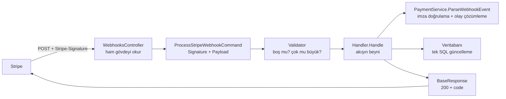

# Stripe Webhook — Kod Kod Rehberi

Bu klasör **yalnızca Stripe webhook işini** anlatır ve **kodu birebir göstererek** "bu satır/blok ne yapıyor, neden var?" sorusunu cevaplar.

Hedef kitle: webhook kavramına yeni olan geliştirici. Her kod bloğunun altında o bloğun ne yaptığı ve neden orada olduğu yazılıdır.

> Kapsam: `POST api/webhooks/checkout` ucu ve arkasındaki tüm kod. Checkout/sipariş oluşturma akışı **bu klasörün dışındadır**.

---

## Webhook ne yapıyor? (30 saniye)

Stripe, bir ödemenin sonucu kesinleştiğinde **bize** bir HTTP isteği atar. Bizim işimiz:

1. İsteğin **gerçekten Stripe'tan geldiğini kanıtlamak** (imza doğrulama),
2. Olayı **okunabilir hâle getirmek** (hangi olay, hangi oturum, hangi sipariş),
3. Olayın **sonuca çevrilmesi** (ödendi / ödenmedi),
4. Siparişin **bulunup güncellenmesi** (bir kez, idempotent),
5. Stripe'a **doğru cevabı vermek** (tekrar denesin mi, denemesin mi).

---

## Akış: istek nereden girer, nerede biter?



---

## Yerel geliştirmede webhook almak (HTTPS zorunluluğu)

> **Stripe webhook'u yalnızca HTTPS adreslere gönderir.** `Development` profilinde API düz HTTP (`http://localhost:5269`) çalıştığı için yerelde webhook alabilmek adına uç noktayı **HTTPS** üzerinden dışarı açmak gerekir; en pratik yol **ngrok**'tur.

| Adım | Komut / Ayar |
| --- | --- |
| 1. API'yi çalıştır | `dotnet run --project src/RestaurantApi.WebApi` → `http://localhost:5269` |
| 2. HTTPS tüneli aç | `ngrok http 5269` → çıktıdaki `https://<id>.ngrok-free.app` adresini kullan |
| 3. Stripe → Webhooks → Add endpoint | `https://<id>.ngrok-free.app/api/webhooks/checkout` |
| 4. İmza sırrını tanımla | panelin verdiği `whsec_...` → `dotnet user-secrets set "Stripe:WebhookSecret" "<whsec_...>"` |
| 5. Olay gönder | panelde **Send test event** ya da `stripe listen --forward-to http://localhost:5269/api/webhooks/checkout` + `stripe trigger checkout.session.completed` |

**Dikkat edilecek noktalar**

- Endpoint URL **`api/` ön ekini içermelidir** (`api/webhooks/checkout`); eksik yazılırsa istek hiçbir controller'a uğramaz ve Stripe panelinde **404** görünür.
- Ücretsiz ngrok adresi her açılışta değişir → paneldeki URL'i güncelleyin (kalıcı çözüm: rezerve/statik domain ya da gerçek sunucu adresi).
- `stripe listen` ile üretilen `whsec_...` yalnızca o oturum için geçerlidir; canlıda panelin verdiği kalıcı değer kullanılır.
- İmza sırrı yanlışsa istek bize ulaşır ama **400 ("Webhook imzası doğrulanamadı.")** döner; bu 404'ten farklı bir durumdur.

**Doğrulama:** Düzeltilmiş bir kurulumda log akışı şöyle görünür:

```text
INF Stripe webhook olayı alındı. EventId:evt_..., EventType:CheckoutSessionCompleted
INF Stripe webhook olayı doğrulandı. EventId:evt_..., EventType:checkout.session.completed
INF Sipariş ödeme durumu webhook ile güncellendi. OrderId:..., PaymentStatus:Paid, OrderStatus:Pending
```

Bu satırlardan hiçbiri yoksa (ve Stripe panelinde 404 varsa) sorun **rota/adres** tarafındadır: endpoint URL'ini ve `api/` ön ekini kontrol edin.

---

## Dosya haritası: hangi doküman hangi kodu anlatıyor?

| Bu klasördeki dosya | Anlattığı kaynak kod |
| --- | --- |
| [01-controller.md](01-controller.md) | `src/RestaurantApi.WebApi/Controllers/WebhooksController.cs` |
| [02-command-ve-validator.md](02-command-ve-validator.md) | `ProcessStripeWebhookCommand.cs`, `ProcessStripeWebhookCommandValidator.cs` |
| [03-handler-handle-metodu.md](03-handler-handle-metodu.md) | `ProcessStripeWebhookCommandHandler.Handle(...)` |
| [04-handler-yardimci-metotlar.md](04-handler-yardimci-metotlar.md) | `ResolveTransition`, `IsSessionPaid`, `ResolveOrderIdAsync`, `ApplyTransitionAsync`, `OrderTransition` |
| [05-imza-dogrulama.md](05-imza-dogrulama.md) | `IPaymentService.ParseWebhookEvent`, `PaymentService.ParseWebhookEvent`, `MapEventType`, `ResolveMetadataValue` |
| [06-modeller-enum-codes-swagger.md](06-modeller-enum-codes-swagger.md) | `StripeWebhookEvent`, `StripeWebhookEventTypes`, `Codes` eklemeleri, Swagger örneği, `ExceptionMiddleware` eşlemesi |
| [07-testlerde-webhook-nasil-taklit-edilir.md](07-testlerde-webhook-nasil-taklit-edilir.md) | `tests/.../Setup/FakePaymentService.cs` (webhook kısmı) |

---

## Tek cümlede her kod parçası

| Kod parçası | Tek cümle |
| --- | --- |
| `WebhooksController` | İsteği karşılar, gövdeyi **ham** olarak okur, komutu kurar, cevabı döner |
| `ProcessStripeWebhookCommand` | `Signature` + `Payload` taşıyan sade bir veri kaydı (record) |
| `ProcessStripeWebhookCommandValidator` | Alanlar boş mu, gövde haddinden büyük mü? |
| `ProcessStripeWebhookCommandHandler.Handle` | Akışın beyni: doğrula → yorumla → bul → güncelle → cevap ver |
| `ResolveTransition` | Olay tipini "sipariş ne olacak" kararına çevirir |
| `IsSessionPaid` | Oturumun `payment_status` alanı gerçekten "para alındı" diyor mu? |
| `ResolveOrderIdAsync` | Olayı doğru siparişle eşler (yoksa 404, çakışırsa 409) |
| `ApplyTransitionAsync` | Tek SQL ile, yalnızca `Pending` siparişi günceller (idempotent) |
| `OrderTransition` | "Şu ödeme durumu + şu sipariş durumu" demek için küçük bir taşıyıcı |
| `PaymentService.ParseWebhookEvent` | **İmzayı doğrular** ve Stripe olayını 5 alanlı kendi modelimize çevirir |
| `StripeWebhookEventTypes` | Sağlayıcıdan bağımsız olay isimleri (enum) |
| `StripeWebhookEvent` | Handler'ın ihtiyaç duyduğu 5 alan |
| `Codes.STRIPE_WEBHOOK_PROCESSED / IGNORED` | Cevaplardaki iş kodları |
| `StripeWebhookProcessedResponseExample` | Swagger'da görünen örnek cevap |

[→ 01 — Controller](01-controller.md)